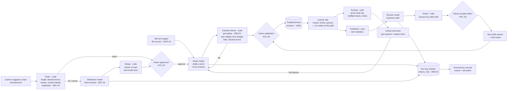

# Architecture — crash-course

## Flow

<!-- --8<-- [start:flow] -->

<!-- --8<-- [end:flow] -->

## A learner's path, and a new topic

<!-- --8<-- [start:sequence] -->
```mermaid
sequenceDiagram
    participant L as Learner
    participant S as Learner site
    participant DB as SQLite
    participant J as Worker
    participant M as Model
    participant O as Owner
    L->>S: register (email) → one-time link
    L->>S: sign up for "dbt"
    S->>DB: enrolment; Familiar unlocked
    L->>S: open quiz
    S->>DB: draw 10 of 13, shuffle, store order
    S-->>L: prompts + options only (no key)
    L->>S: submit (positions)
    S->>DB: map back, score, best score, attempt
    L->>S: "I completed the project"
    S->>DB: quiz passed + project → Familiar complete, Beginner unlocked
    S->>DB: queue build dbt/beginner
    J->>M: writer drafts Beginner (schema)
    J->>J: content checks
    J-->>O: email: draft ready (signed links)
    O->>S: review → publish
    S-->>L: Beginner appears on the tracker
    L->>S: suggest "Apache Kafka"
    S->>S: rules
    S->>M: moderator assessment (delimited)
    S-->>O: email: assessment + approve / reject
    O->>S: approve (confirm page → POST)
    S->>DB: course created; Familiar queued
```
<!-- --8<-- [end:sequence] -->

## Decisions

<!-- --8<-- [start:decisions] -->
| Decision | Chosen | Why | Alternatives considered |
|---|---|---|---|
| Who writes the 38 × 3 levels | Familiar written at build time from each tech page; Beginner and Intermediate drafted by the model when the first learner unlocks them | 38 courses are live from day one; deeper levels cost nothing until someone needs them; each one is still reviewed | Draft all 114 up front (a big review backlog nobody asked for); model-only from day one |
| Where content lives | Versioned YAML: bundled levels in git, runtime versions in the data volume | Every change has a diff, an author (alias, prompt hash) and an approver; rollback is a file | Content in database rows; a headless CMS |
| Grounding check | Each question's evidence must appear verbatim in the source page or the level's own text | Deterministic, cheap, explainable — a reviewer sees the exact sentence | LLM-as-judge for faithfulness (non-deterministic, costs per check) |
| Who scores quizzes | Code on the server; keys never sent to the browser | A model can't pass anyone; learners can't read the key from the page | Client-side quiz (key in the page); model-graded free text |
| Unlock rule | Quiz passed at least once **and** project marked done | The owner's choice; self-attested projects keep it honest without file uploads | Quiz only; time-based unlock |
| Moderation | Rules first, then a model in a fixed schema; the stricter result wins; the owner decides | A rule can't be argued away by the text it is screening; the model adds judgment for the unclear cases | Model only; rules only; a hosted moderation API |
| Owner approvals | Signed, expiring email links that open a confirmation page; plus an owner page on the live site | Works from a phone; a mail scanner following links can't approve anything | Admin password; approvals only in the operator app |
| Sign-in | Magic links by email (Resend), signed session cookies | No passwords to store or leak | OAuth providers; Cognito |
| Learner site stack | FastAPI + Jinja + Alpine.js (vendored, no build step) | Server-rendered and fast; small interactive pieces (one question at a time) without a front-end build | HTMX (used in daily-puzzle); React/Next.js |
| Background work | A jobs table in SQLite and a worker thread | A 4-hour course draft never blocks a web request; no extra service to run | Celery/Redis; APScheduler |
| Kill switch scope | Pauses model calls and approval mail; sign-in and quizzes keep working | Pausing the AI shouldn't lock learners out of material already approved | Pause the whole site |
<!-- --8<-- [end:decisions] -->
