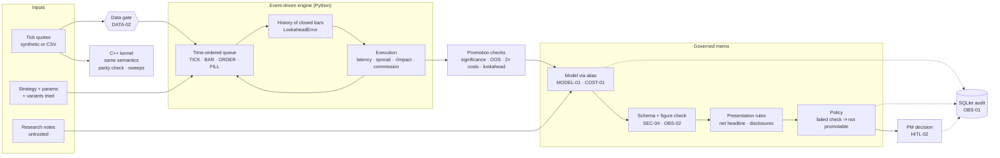
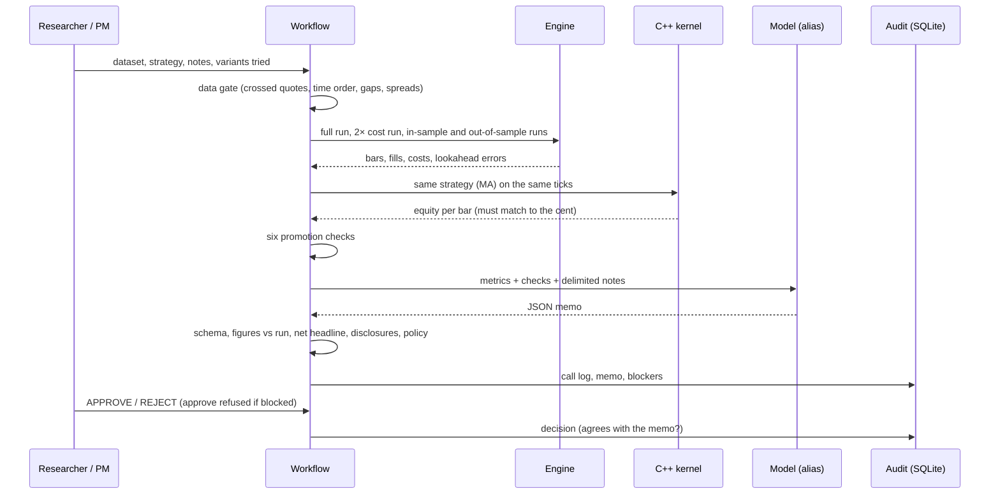

# Architecture — event-backtester

## Flow

<!-- --8<-- [start:flow] -->

<!-- --8<-- [end:flow] -->

## One run, end to end

<!-- --8<-- [start:sequence] -->

<!-- --8<-- [end:sequence] -->

## Design decisions

<!-- --8<-- [start:decisions] -->
| Decision | Chosen | Why | Alternatives |
|---|---|---|---|
| Engine style | Event-driven, one event queue, ticks streamed one at a time | Makes lookahead structurally impossible and models latency and fills honestly | Vectorised pandas (fast, easy to leak the future); backtrader / zipline |
| Lookahead guard | Bars published only after the next bucket's first tick; read-only `History`; `LookaheadError` | A leak fails loudly instead of inflating results | Code review and hope |
| Speed | C++ kernel (pybind11, `std::thread`) for the MA strategy's sweeps and walk-forward | Grids of hundreds of tick-level backtests in seconds | Numba; vectorbt; a full C++ engine (less readable) |
| Trusting the kernel | Same semantics implemented twice, compared to the cent on 144 configurations and on every run | A fast engine that drifts from the reference is worse than a slow one | Trust the fast path |
| Promotion gate | Six checks in code: lookahead, fills, selection-adjusted t, out-of-sample Sharpe, degradation, 2× cost Sharpe | The decision's inputs must not depend on a model | Model judges the backtest (unauditable) |
| Selection bias | t-stat minus √(2 ln N) for N declared variants | Cheap, explainable haircut for best-of-N | Deflated Sharpe ratio (Bailey & López de Prado); combinatorial purged CV |
| Model's job | Draft the memo inside a schema; every figure and the headline checked | Saves write-up time without letting prose move numbers | No model; model-written conclusions |
| Who decides | A named PM; approve refused when anything is blocked | Capital allocation is a human decision | Auto-promote on a passing gate |
| Data format / store | Parquet ticks; SQLite audit | Columnar, compressed ticks; zero-infra audit | DuckDB / Arrow datasets; Postgres |
<!-- --8<-- [end:decisions] -->

## Code map

```
cpp/core.cpp            C++ kernels: resample, MA-cross simulator, multithreaded sweeps → event_backtester._core
src/event_backtester/
  engine.py             event queue, History guard, execution, portfolio
  data.py               synthetic ticks, CSV loader, resampling
  strategies.py         MA cross, Donchian, Bollinger, vol-target momentum, leaky (for the demo), custom code
  gates.py              data gate and promotion checks
  workflow.py           checks → memo → validate → figure + presentation checks → policy → audit; decide()
  guardrails.py         injection scan, redaction, schema parse, figure check, presentation rules, policy
  walkforward.py        kernel sweeps and walk-forward;  metrics.py  performance, round trips, cost waterfall
  llm.py / mock_model.py   registry, budgets, fallback; deterministic gullible mock
  evals.py · store.py · telemetry.py · ui.py (+ lab/ pages)
```
