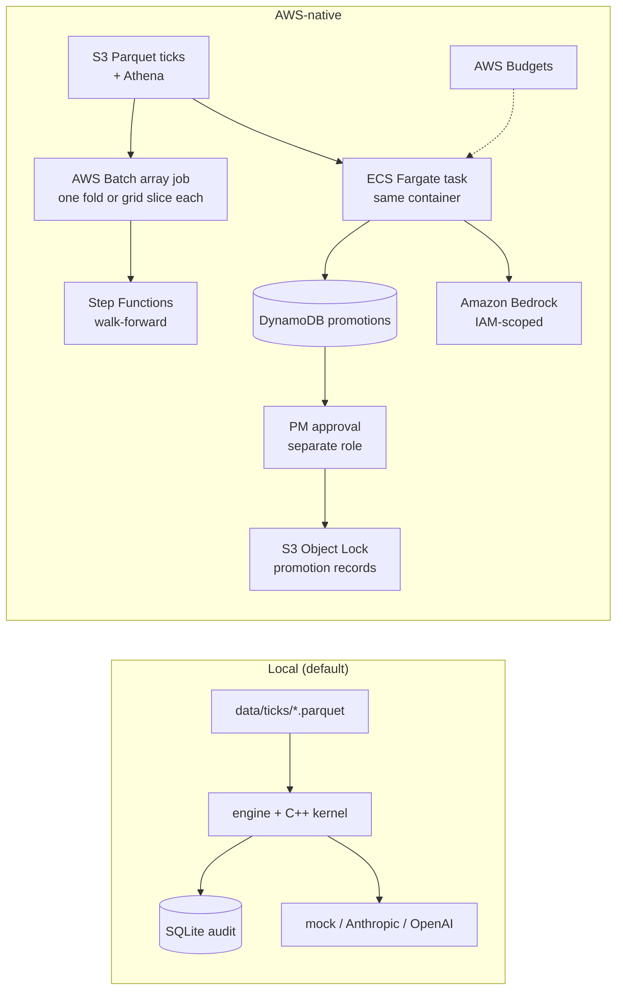

# Running event-backtester AWS-native

Same package, C++ kernel, prompts, evals and governance config. What changes is where each piece runs.



| Concern | Local | AWS-native | Change required |
|---|---|---|---|
| Tick data | Parquet files | S3 (partitioned by date) + Athena for exploration | read with `pd.read_parquet("s3://…")` (s3fs) |
| Backtests | one process | ECS Fargate task; large sweeps as AWS Batch array jobs, walk-forward as a Step Functions Map over folds | split the grid by index (the kernel's sweep already takes lists) |
| Model | `memo-primary: mock-local` | Bedrock | set `bedrock-claude.model_id` + pricing, eval, `promote` |
| Secrets | `.env` | IAM task role | none |
| Decisions | SQLite `promotions` | DynamoDB (task writes requests; only the PM role writes decisions) + S3 Object Lock records | write via boto3 (next increment) |
| Budgets | `cost.*` | same **plus** AWS Budgets forecast alert | set `monthly_budget_usd`, `alert_email` |

## Steps

```bash
cd infra/aws
cp terraform.tfvars.example terraform.tfvars
terraform init && terraform plan          # starter: review before apply
docker build -t event-backtester . && docker push <ecr-url>:latest
```

The Terraform is a reviewed starter, not applied to a live account.
