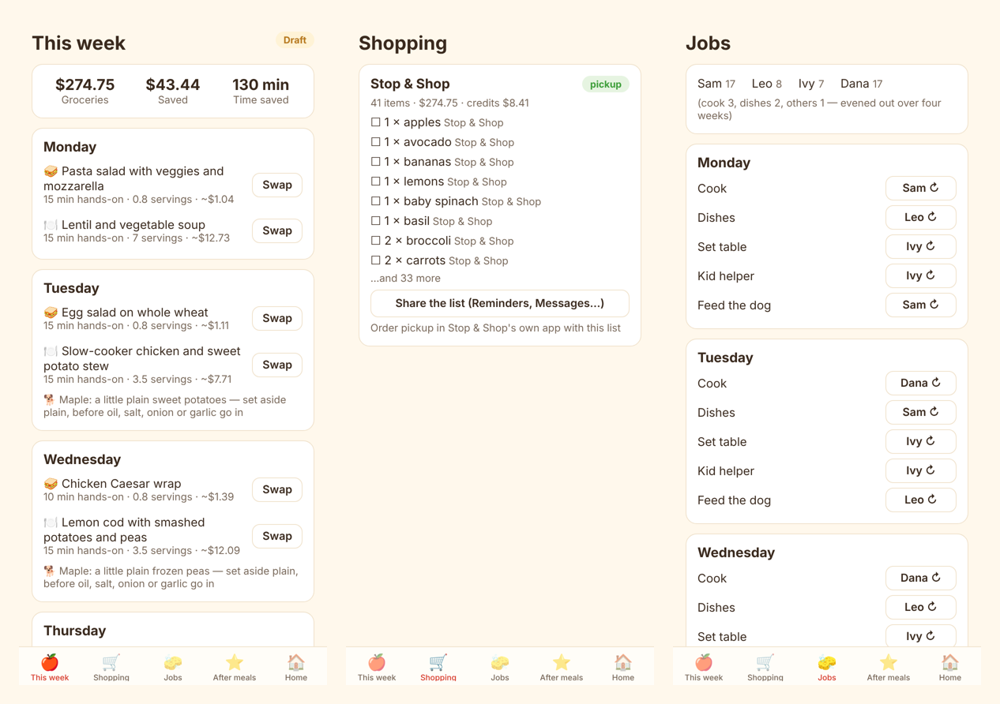

# DinnerPeace


**A family meal planner that picks the week's meals, splits the shopping across stores by price and specials, shares
the cooking and cleanup, and learns how much everyone — the dog included — actually eats.**

> Part of the [AI Workflow Portfolio]({{SITE_URL}}) by Ruairi Powers · a personal project ·
> Write-up: [{{SITE_URL}}/personal/lil-helper/]({{SITE_URL}}/personal/lil-helper/) ·
> Governance: [this project's mapping](docs/governance.md)

## What it does

- **Opens on Today:** the next meal and who's cooking, your jobs, the shopping, anything waiting for an answer,
  birthdays and holidays coming up, and a microphone: "what's for dinner?", "I have half a chicken, rice and
  broccoli", "we have 3 portions of oats left".
- **Five ways to decide, besides the weekly plan:** *Make a plan* (a week or up to three months ahead, and stick to
  it), *Vibe cooking* (the time you have and your mood → ideas, and an order for what's missing), *Special occasions*
  (birthdays, anniversaries, holidays, "soccer pizza party" — the person's favourites first, sized for the guests),
  *Weekly buffet* (no recipe per day: keep N portions of a few things, count what's left once a week, and the plan
  cooks just enough to refill), and *Surprise me*.
- **People with birthdays:** child (under 12) or adult follows from the birthday; teens (12–17) get adult portions but
  approve spending only if the admin allows; nobody has jobs on their birthday.
- **Meals with parts:** cook the curry for three while two heat up Monday's leftovers or have something ready-made;
  people on another part come off the recipe and the shopping list.
- **Plans the week** for the meals you turn on (dinners every night, weekend breakfasts, school lunchboxes), from
  recipes the family likes plus two new ideas a week. A solver fits everyone's allergies and diets (hard rules), each
  day's hands-on cooking limit, variety, the season where you live, the budget and this week's specials. Swap any
  meal; the rest of the week stays put.
- **Splits the shopping** across Whole Foods, Trader Joe's, Costco, Stop & Shop (or your stores) by shelf price,
  specials, pickup and delivery fees, delivery markups, and membership and card credits — three ways: cheapest,
  balanced (your time is worth something), fastest.
- **Hands each list to the app that already does it:** an Instacart shopping-list link, a list shared to the Whole
  Foods app or Reminders, an aisle-ordered list for Trader Joe's (which doesn't sell online). Nothing is bought by
  DinnerPeace; an adult approves the week first.
- **Shares the jobs:** cook, dishes, set the table, kid helper, feed the dog — fair over four weeks, by who's home
  and what each age can do.
- **Feeds the dog:** restocks its food with the groceries, and sets aside plain, dog-safe extras from dinner (capped
  at 10% of its daily calories). Grapes, onion, garlic, chocolate, xylitol and anything your vet named are blocked.
- **Fits real weeks:** dinner times per day and who's home each night; takeout, eating-out, leftovers and freezer
  nights (with their budget, the card credit that applies, like Uber Cash, and the best card to pay with); cooking a
  bit extra for tomorrow's lunch; a kid chef night with something that child can make; one-pot Mondays.
- **Costs:** a weekly budget against what's planned and what was spent, with spending from card statements (only
  food rows kept), receipts (photo or emailed text) or typed in; a dinner cost-per-serving range the planner keeps
  to; reports per week, per meal and per person; the best card for each order, with yearly bonus caps.
- **Shopping trips you schedule:** day, time, store, in store / pickup / delivery, and who goes; fresh things go on
  the trip nearest the day they're cooked. Specials by store, in store or online, this week or every week.
- **Fridge and freezer:** buys ahead on a sale only when it fits and keeps until it's needed; cooks extra of
  freezes-well dinners for freezer nights.
- **Forecasts an ingredient:** how much the next weeks' plans need, what's on hand, which trip to buy it on, how
  much, and where it's cheapest. **Cook from what I've got** turns what's in the kitchen into ideas.
- **Your own recipes:** ingredients in everyday words, cooking steps, calories per serving, which meals they suit
  (breakfast, lunch, dinner), the months they're in season, how often you'd like them, and where each is from. Every
  recipe in DinnerPeace's book has steps and calories; use the book and its indicative prices, or turn the book off.
  **Your brand, store and price** for any ingredient apply to every plan and list. Add one from the web (search the sites you like, or paste a link: name, ingredients,
  times and a link back come in, ready to check), export and import the book as a file, or share it with another
  household by code.
- **Change any planned meal** to a recipe from the book, one of yours, a new one or one from the web — and undo it.
  As the week goes on, each meal shows what happened (eaten, leftovers, how much went in the freezer); freezer meals
  can be edited, and ones near their use-by are planned first.
- **Keeps everyone in the loop:** each person subscribes their own calendar (Apple, Google, Outlook) to their
  dinners, jobs and shopping trips; every dinner has one-tap links to rate it and say how much is left, and a link
  that opens the app; shopping events carry the whole list, in aisle order for in-store trips. Push
  notifications when the plan is ready, when tonight changes, before a shopping trip, and after dinner. A weekly
  email and fridge calendars (PDF).
- **Learns:** after each meal, one tap for how much was eaten and a rating. Portions adjust; the savings report
  shows dollars, minutes and satisfaction against a stated baseline.
- **Specials from a flyer photo:** a vision model reads it; a person confirms before it counts; typo prices are flagged.
- **Households and roles:** a welcome wizard sets up a household; its admin adds and invites everyone; adults plan
  and approve; kids see the plan and their jobs and rate meals.
- **Bulk import and export:** the admin downloads everything the planner uses — household, people, occasions,
  recipes and their ingredients, ingredient brands/stores/prices, fridge, pantry and freezer — as one Excel
  workbook, edits it, and uploads it; a preview shows every add, change and removal before anything is saved.
- **Reports:** costs (planned against spent), time (cooking, shopping, planning), calories planned per person, and
  who did which jobs.
- **Voice and Alexa:** the app's microphone (the phone's own speech recogniser) fills any box or answers a question;
  "Alexa, ask DinnerPeace what's for dinner" works through a skill you add in the Amazon developer console
  ([docs/alexa.md](docs/alexa.md)). Requests are matched by rules, not a model; nothing is bought by voice.

## Dinner Peace Pro (for personal chefs)

A higher subscription on the chef's own account, in the same app. A chef is a member (role `chef`) of each client
household, so the family's allergies, likes, brands and week stay in the family's own folder, and the family sees what
the chef logs in their own app, free.

| Plan | Price | Unlocks |
|---|---|---|
| Family Free | $0 | A 7-day plan, an aisle-sorted list, recipes, every allergy and pet rule (never behind a plan) |
| Dinner Peace Family | $4.99 / month, $39 / year | Planning up to 12 weeks ahead, cook from what I have, fridge calendars, import and export. **Free for any household with a Pro chef in it** |
| Chef Solo | $29 / month, $290 / year | Up to 3 client homes: the "What do I do next?" cockpit, client dossiers, the numbered container log, reheat cards (4×6 labels, letter page, email), voice logging, client budgets and receipts |
| Chef Studio | $59 / month, $590 / year | Unlimited homes, one shopping trip across homes with bulk packs split by quantity, card routing (your card → rewards → client invoice, or their card → separate checkout), coverage packs for a backup chef, your branding on labels |

- **Cockpit:** today's kitchens in time order, the next step in each ("Cook beef and broccoli (3 servings) and pack
  container #3"), the strictest allergy first, containers to use soon, and the next store stop with the card to use.
- **Voice notes:** "At the Millers. Chucked the leftover lasagna, made 4 portions of short ribs. Freeze two, fridge
  two. Reheat at 350 for 25 minutes covered. They're out of olive oil." becomes a preview (toss #1, two containers, a
  reheat card, olive oil on their list); nothing is saved until the chef confirms. Parsed by rules, not a model.
- **Allergens:** a reheat card or voice note naming something a household member is allergic to is refused until the
  chef confirms it, and the label then says "Contains: …".
- **The trip:** chooses up to `max_stops` stores (default 2) by item cost plus the chef's time in each store, merges
  lines across homes the chef pays for, splits each line's cost by quantity to the cent, and orders stops so the
  cold things come last. Brand preferences keep a home's lines separate.
- **Coverage packs:** a link that opens with a password (sent separately) only between its dates; "recipes and
  routines" leaves out addresses and door codes, "full" includes them.
- **Billing:** the server decides what each plan unlocks (`plans.py`); a locked feature answers 402 and the app
  shows the plan page. Plans are set with `helper plans set` until the App Store release, then by the RevenueCat
  webhook (`/api/billing/revenuecat`).

`helper chef-demo --email you@example.com` sets up a fictional chef on Studio with three client homes.

The family uses the **phone app** (`app/`, Expo — iPhone first via TestFlight, Android from the same code), in the
Dinner Peace look: sage and kraft, Nunito, the new icon. Chefs get their own tabs (Next, Clients, Shop, Ledger, More)
with a kraft voice button.

 The
**Streamlit demo** shows the same engine on a fictional family.

## Quickstart

```bash
pip install -e ".[ui,dev]"
helper plan                   # one week for the fictional Rivera family, offline mock model
helper simulate --weeks 4     # draft → approve → meal feedback → portions learn, four times
helper eval                   # golden-set gate (allergens, dog safety, constraints, shopping, injection)
helper ui                     # Streamlit demo: input → run → output
helper serve                  # the API the phone app talks to (http://localhost:8650)
helper chef-demo --email chef@example.com   # Dinner Peace Pro: a fictional chef with three client homes
helper plans set chef_studio --email chef@example.com   # turn a plan on (RevenueCat does this in production)
pytest -q
cd app && npm install && npx expo start     # the phone app (Expo Go, or press w for web)
```

**Setting it up for real** (the server on the EVO-X1 behind Cloudflare, the app through TestFlight, then the
welcome wizard): [docs/household-setup.md](docs/household-setup.md). **Going to the App Store** (hosted service,
subscriptions, children's privacy): [docs/aws-native.md](docs/aws-native.md).

On a server, households are created in the app (or `helper household create|import`); the demo and the CLI use the
fictional family in `config/household.example.yaml`.

## Results (offline, mock model, fictional family, synthetic prices)

Eight simulated weeks (`helper simulate --weeks 8`):

| Measure | Result |
|---|---|
| Dollars saved vs the home store at regular prices, one trip | $190.54 over 8 weeks ($23.82 a week; 17% of the baseline) |
| Minutes saved a week | ~120, of which ~73 is the family's own estimate of planning time before (75 min) minus 1–2 min approving, and the rest a pickup instead of a store trip |
| Plans with an allergen for someone eating | 0 of 8 weeks |
| Dog extras held back | 6 (toxic, or not on the dog-safe list) |
| Adults' job load over 8 weeks | 132 and 132 (cook 3, dishes 2, others 1) |
| Kid chef nights kept | 8 of 8 (the book has one dinner marked for a 9-year-old, so it repeats; add your own recipes to vary it) |
| Average meal rating | 4.21 / 5 (simulated reactions from the family's likes and dislikes) |
| Model cost | $0.047 for 8 weeks (simulated pricing; $0 on local models) |
| A week's plan, split and jobs | about 1 s; 5.3 s for all eight weeks |

Eval gate: 20 of 20 cases, must-reject recall 1.00 (hidden allergens in model ideas and household recipes, dog-toxic
foods and vet notes, a $0.09 "special", instructions hidden in a flyer and a receipt, card numbers, a kid chef's
name kept from the model).

What the numbers rest on: the prices, specials and fees are synthetic; with these prices the balanced option chose
Stop & Shop pickup in seven of eight weeks (Whole Foods pickup plus Stop & Shop delivery in the other). The ratings
and leftovers come from a simulated family, so "food left over" moves around (1–8% a week) rather than showing a
clean trend. Time saved is mostly the household's own before-estimate. Real numbers need real weeks.

## Configuration

Each household's settings are edited in the app (**More**), or all at once as an Excel workbook (**More → Import and export**); the admin changes them, and every save is validated.
The same sections, for the CLI and the demo, are in `config/household.example.yaml`:

| What | Section |
|---|---|
| People (birthday or adult/child, allergies, diets, portion, home days, can cook, admin, teen approval, email); pets | `people`, `pets` |
| Occasions and holidays | `occasions`, `holidays`, `holidays_off` |
| Weekly buffet (per meal: recipes and portions to keep) | `buffet` |
| Your brand, store and price per ingredient; use DinnerPeace's book | `ingredient_prefs`, `use_book` |
| Dinner days and times, breakfasts, lunchboxes, nights off | `meals`, `dinner_times`, `meals.special_nights` |
| Takeout and eating out: budget and service | `eating_out` |
| Hands-on minutes by day; styles to prefer or require; kid chef nights; leftover lunches | `prep_minutes`, `styles`, `kid_chef`, `leftovers` |
| Budget, cost per serving, time value | `household.budget_per_week`, `cost_per_serving`, `household.time_value_per_hour` |
| Stores, home store, memberships, cards (names only) | `stores`, `home_store`, `memberships`, `cards`; fees in `config/stores.yaml`, card benefits in `config/money.yaml` |
| Shopping trips | `shopping_sessions` |
| Fridge and freezer, freezer meals, weeks planned ahead | `storage`, `freezer_meals`, `plan_ahead_weeks` |
| Health preferences, brands | `health`, `brands` |
| Jobs, ages, fairness window | `chores` |
| Weekly email | `outputs.email` |
| Server: sign-up, push, public address, scheduler, Alexa skill id | `.env` (see `.env.example`) |
| Solver weights, typo-special threshold, dog extras cap, portion learning | `config/settings.yaml` |
| Models | `config/models.yaml` (aliases `helper-suggest`, `helper-vision`, `helper-notes`, `helper-fallback`, `helper-candidate`) |

## Use-case card (HITL-04)

| | |
|---|---|
| **Intended use** | Households planning their own meals, shopping, spending and kitchen jobs. |
| **Not for** | Medical or clinical nutrition (health settings are preferences, not advice); veterinary advice (follow your vet); buying anything automatically; financial advice (card suggestions come from published benefits, each with the date it was checked). |
| **Risk tier** | Medium: children's data, allergies, a dog, and real spending (through a person). |
| **Owner** | Ruairi Powers |
| **Known limits** | Allergen safety depends on the ingredient list and its synonyms being complete — check labels. Prices are only as good as what the household enters or photographs; there is no live price feed. Instacart chooses which store a link opens (the list asks for the right one). Trader Joe's is in-store only. The mock model is a stand-in. |

## Architecture

See [docs/architecture.md](docs/architecture.md), [docs/governance.md](docs/governance.md) and
[docs/aws-native.md](docs/aws-native.md). The phone app: [app/README.md](app/README.md).

## License

Apache-2.0, by Ruairi Powers, built with Claude: keep the NOTICE file and credit the project if you reuse it (see [NOTICE](NOTICE)).
