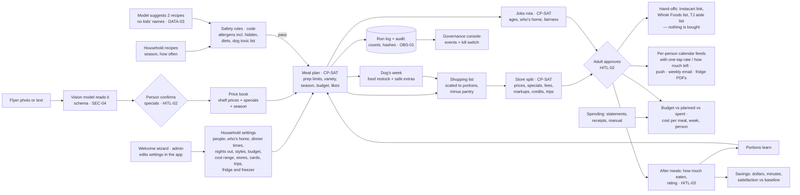
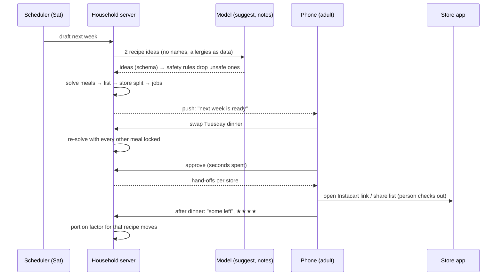

# Architecture — Lil'Helper

## Flow

<!-- --8<-- [start:flow] -->

<!-- --8<-- [end:flow] -->

## A week in the app

<!-- --8<-- [start:sequence] -->

<!-- --8<-- [end:sequence] -->

## Why this shape

<!-- --8<-- [start:decisions] -->
| Decision | Chosen | Alternative | Why |
|---|---|---|---|
| Who chooses meals and stores | A constraint solver (OR-Tools CP-SAT) in code | Ask a model for a meal plan | Allergies, prep limits, budget and fees are hard rules with numbers; a solver either meets them or says it can't. The model suggests recipes and writes one-line notes, inside a schema |
| Allergies and the dog | Hard rules in code with hidden-source synonyms ("satay" → peanut, "pesto" → tree nut) and a dog-toxic word list; vet notes blocked the same way | Trust the model to avoid them | A wrong plan can make someone ill. Rules run on every plan, idea, special and dog extra, and a model can't override them |
| Buying | Hand off to the app that already does it: Instacart shopping-list link (Developer Platform), a list shared to the Whole Foods app or Reminders, an aisle-ordered Trader Joe's list | Place orders from Lil'Helper | Integrate, don't rebuild; and nothing spends money without a person tapping through |
| Specials | A flyer photo the household takes, read by a vision model, confirmed by a person; typo prices flagged | Scrape store websites | Store terms of service; Trader Joe's has no online store or sales; a confirmed special is a fact, a scraped one is a guess |
| Calendar | A private .ics feed per person (their dinners, jobs, trips), subscribed once in Apple, Google or Outlook; each dinner carries signed one-tap links to rate it and say what's left | Writing events through each calendar's API | One feed works with every calendar app and needs no calendar permissions; the links record feedback only from the page's own request, so link previews can't rate a meal |
| Accounts | Email sign-in links; one central accounts database; each household in its own folder and database; roles (admin, adult, kid) checked on every request | Passwords; one shared database from day one | Nothing to forget or leak; a household's data can't be reached through another's session, and moving to Postgres with row-level security later keeps the same boundary (docs/aws-native.md) |
| Changing an approved week | Applied in place: a night switched to takeout drops that dinner (the food stays in the pantry), who's home updates the eaters, nights out are re-costed; never re-shops | Re-plan the week | The shopping is done; re-planning would change what was bought |
| The phone app | Expo (React Native): iPhone via TestFlight first, Android from the same code | Native Swift; a web app on the home screen | One codebase for both phones, real push and secure storage, no Mac needed to build (EAS) |
| Where data lives | Now: one server at home (the EVO-X1) behind Cloudflare, SQLite per household. For the App Store: AWS with Postgres and row-level security | Hosted from day one | One family and a few testers don't need a cloud bill; the code is already multi-household, so the move is a storage swap, not a rewrite |
| Reproducibility | One solver worker, fixed seeds | Parallel search | The same inputs give the same plan, so a test or a savings number can be repeated (at ~6 s a week, inside the 10 s target) |
<!-- --8<-- [end:decisions] -->

## What's next

- **App Store release:** hosted service, subscriptions through RevenueCat, privacy policy and children's handling —
  the plan and checklist are in [aws-native.md](aws-native.md).
- **Real models on the EVO-X1:** `local-qwen` for ideas and notes, a local vision model for flyers and receipts; run
  `helper eval --alias helper-candidate` and promote only on a pass.
- **Instacart for real:** a Developer Platform key turns delivery lists into one-tap links.
- **Bank and card feeds** (Plaid or similar) instead of statement files, if importing monthly gets old.
- **More kid chef recipes**, so a child's night isn't the same dinner every week.
