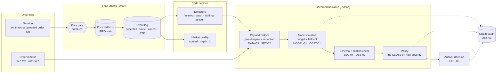
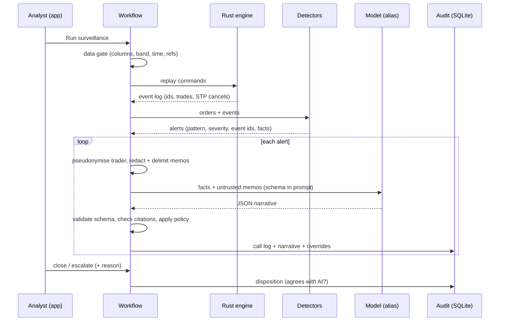

# Architecture — lob-matching-engine

## Flow

<!-- --8<-- [start:flow] -->

<!-- --8<-- [end:flow] -->

## One alert, end to end

<!-- --8<-- [start:sequence] -->

<!-- --8<-- [end:sequence] -->

## Design decisions

<!-- --8<-- [start:decisions] -->
| Decision | Chosen | Why | Alternatives |
|---|---|---|---|
| Engine language | Rust, exposed to Python with pyo3/maturin | Predictable latency (no GC), memory safety, one wheel for every Python ≥ 3.9 (abi3) | C++ (pybind11), Java/LMAX-style, pure Python (≈100× slower) |
| Book layout | Dense price ladder + intrusive FIFO lists in a slab | O(1) add / cancel / fill and no allocation in steady state; best price is a cached index | `BTreeMap` of levels (simpler, O(log n), worse tails); skip lists |
| What decides an alert | Rules in code over the engine's event log | Deterministic, testable, explainable to a regulator; the model can't invent or suppress alerts | Model classifies raw events (unauditable); ML anomaly score (needs labels) |
| Model's job | Draft a cited narrative inside a schema | Saves the reconstruction time; every figure and event id is checked against the log | No model (slower reviews); agent with query tools (more risk for little gain) |
| Pattern | Workflow, not an agent | Fixed steps, no tools, nothing for a prompt injection to call | LangGraph agent with read-only SQL tools |
| Who decides | A named analyst; high-severity closes need a reason | Surveillance outcomes are compliance decisions | Auto-close low severity (left as a config option, off) |
| Store | SQLite | Zero infrastructure, one file per visitor in the demo, queryable audit | DuckDB, Postgres; DynamoDB + S3 Object Lock on AWS |
| Benchmark method | Untimed replay for throughput; per-command timer for latency | The timer would deflate throughput; tails need per-command samples | Sampling profiler; hardware timestamps (needs NIC support) |
<!-- --8<-- [end:decisions] -->

## Code map

```
rust/src/book.rs      order book, matching, stops, STP, invariants
rust/src/flow.rs      synthetic flow, benchmark harness, simulator
rust/src/python.rs    pyo3 bindings → lob_matching_engine._engine
src/lob_matching_engine/
  sessions.py         session generator, data gate, replay, market quality
  detectors.py        layering, wash (STP-blocked), stuffing, ignition
  workflow.py         payload → model → validate → cite-check → policy → audit; dispose()
  guardrails.py       injection scan, PII redaction, pseudonyms, schema parse, citation check, policy
  llm.py / mock_model.py   registry, budgets, fallback; deterministic gullible mock
  evals.py            golden set + gate;  store.py  SQLite audit;  telemetry.py  governance console client
  ui.py               Streamlit: Surveillance workflow + Engine lab pages (lab/)
```
