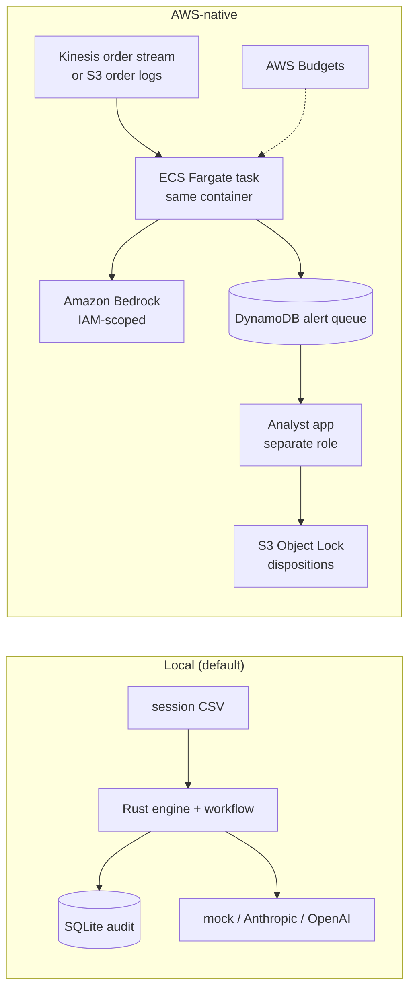

# Running lob-matching-engine AWS-native

Same Python package, Rust engine, prompts, evals and governance config. What changes is where each piece runs.



| Concern | Local | AWS-native | Change required |
|---|---|---|---|
| Order flow | session CSV | Kinesis Data Stream (live) or S3 order logs (batch) | a small reader that turns records into the `sessions.COLUMNS` shape |
| Engine | wheel built by maturin | same wheel in the ECS image; for latency work, EC2 with pinned cores (c7i, `isolcpus`) | none for surveillance replay |
| Model | `narrative-primary: mock-local` | Bedrock | set `bedrock-claude.model_id` + pricing, point `narrative-candidate` at it, run the eval gate, `promote` |
| Secrets | `.env` | IAM task role (no model key exists) | none |
| Alerts | SQLite `alerts`, `narratives` | DynamoDB alert queue (task writes; analysts' role updates) | write via boto3 (next increment) |
| Dispositions | SQLite `dispositions` | S3 Object Lock, compliance mode, ~7 years | append JSON per disposition |
| Budgets | `cost.*` in config | same config **plus** AWS Budgets forecast alert | set `monthly_budget_usd`, `alert_email` |

## Steps

```bash
cd infra/aws
cp terraform.tfvars.example terraform.tfvars   # owner, email, approved model ARNs
terraform init && terraform plan               # starter: review before apply
docker build -t lob-matching-engine . && docker tag lob-matching-engine <ecr-url>:latest && docker push <ecr-url>:latest
```

The Terraform is a reviewed starter, not applied to a live account. Check it with `terraform validate` and read the
plan before applying.
