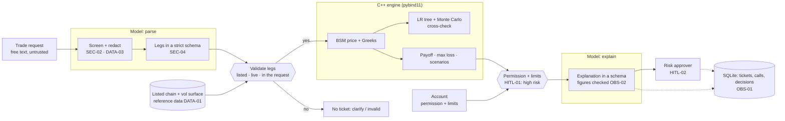
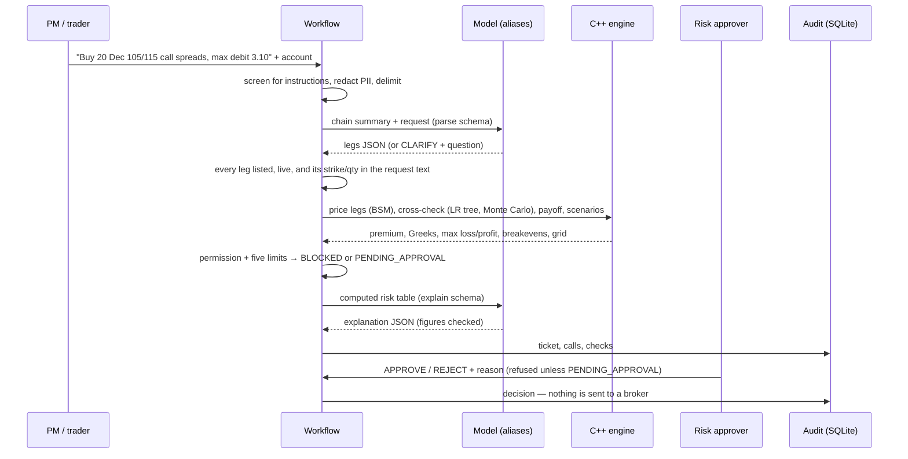

# Architecture — options-greeks-engine

## Flow

<!-- --8<-- [start:flow] -->

<!-- --8<-- [end:flow] -->

## One ticket, end to end

<!-- --8<-- [start:sequence] -->

<!-- --8<-- [end:sequence] -->

## Design decisions

<!-- --8<-- [start:decisions] -->
| Decision | Chosen | Why | Alternatives |
|---|---|---|---|
| Pricing engine | C++17 with pybind11; BSM, CRR / JR / Leisen-Reimer trees, Monte Carlo (antithetic, control variates, LSM) | Speed where it matters (MC, trees, surfaces) with a Python-friendly API; the methods cross-check each other | QuantLib (heavier, less to show); pure NumPy (slow MC) |
| Monte Carlo threading | `std::thread` over fixed blocks seeded by block id | Same answer for any thread count; common random numbers for bump-and-revalue Greeks | OpenMP (simpler, non-deterministic splits); GPU (CuPy) |
| Model's jobs | Parse text into legs; explain computed risk | Removes re-keying; the explanation saves the approver time | Model prices or checks limits (unauditable) |
| Trusting the parse | Every leg must be on the chain, live, and its strike and quantity must appear in the request | Stops invented strikes and added legs; ambiguity becomes a question | Confidence scores; a second model to verify |
| Limits and permissions | Code, per account, blocking | High-risk tier: the controls can't be probabilistic | Model-scored suitability |
| Who decides | A named risk approver with a reason; blocked tickets can't be approved; nothing is sent | Leverage and potentially unlimited loss | Auto-approve small tickets (an option, off) |
| Pattern | Workflow with two narrow model calls | No tools for an injection to call | Agent with pricing tools |
| Store | SQLite | Zero infrastructure, per-visitor in the demo | DynamoDB + S3 Object Lock on AWS |
<!-- --8<-- [end:decisions] -->

## Code map

```
cpp/optlib.cpp            BSM, implied vol, trees (CRR/JR/LR, American, boundary), Monte Carlo (European/Asian/barrier,
                          antithetic, control variates), LSM, closed forms → options_greeks_engine._optlib
src/options_greeks_engine/
  market.py               chain, vol surface, expiry mapping, accounts (reference data)
  pricing.py              ticket pricing, Greeks, payoff, max loss/profit, scenarios, cross-check
  workflow.py             screen → parse → validate → price → limits → explain → ticket; decide()
  guardrails.py           injection scan, redaction, schema parse, leg validation, limits, figure check
  llm.py / mock_model.py  registry, budgets, fallback; deterministic rule-based mock
  evals.py · store.py · telemetry.py · ui.py (+ lab/ pages)
```
