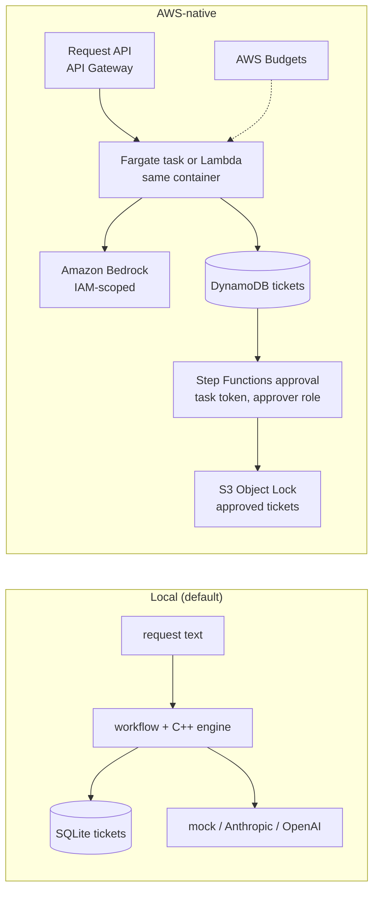

# Running options-greeks-engine AWS-native

Same package, C++ engine, prompts, evals and governance config. What changes is where each piece runs.



| Concern | Local | AWS-native | Change required |
|---|---|---|---|
| Reference data | YAML in git | S3 (versioned) loaded per session; a vendor feed later | point `market_file` at the S3 copy |
| Engine | wheel built from `cpp/` | same wheel in the image | none |
| Model | `parse-primary` / `explain-primary` → mock | Bedrock (a small model for parsing, a larger one for explanations) | set models + pricing, eval, `promote` |
| Approval | the app's approval tab | Step Functions with a task token: only the approver role can send the token back | wire `decide()` to `SendTaskSuccess` (next increment) |
| Tickets | SQLite | DynamoDB + S3 Object Lock for approved tickets | write via boto3 |
| Budgets | `cost.*` | same **plus** AWS Budgets | set `monthly_budget_usd`, `alert_email` |

## Steps

```bash
cd infra/aws
cp terraform.tfvars.example terraform.tfvars
terraform init && terraform plan          # starter: review before apply
docker build -t options-greeks-engine . && docker push <ecr-url>:latest
```

The Terraform is a reviewed starter, not applied to a live account. Nothing in this design routes orders to a broker.
