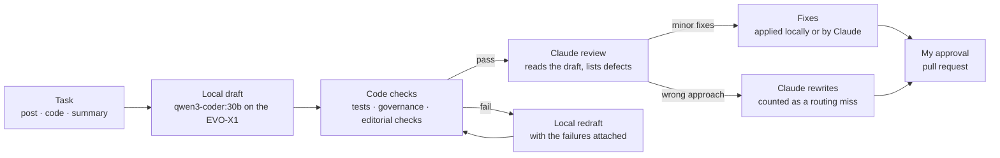

# Local model drafts, Claude reviews: what moving the first draft home is worth

Most of what I ask Claude to do on this site has two parts: write something, then check it. Writing is the bulk of
the tokens. Checking is where a frontier model earns its keep. So I'm moving the first draft to the model running on
my own GPU and keeping Claude for the review. This post sets out how I'll measure whether that's worth it, and the
first numbers.

<!-- more -->

!!! note "Status"
    Draft. The measured numbers below come from one task. The results table fills in as the routing runs on the
    daily posts; this post publishes once it holds at least a month of them.

## The problem

My Claude plan has a usage limit, and the work that hits it hardest is the work that's easiest to delegate: first
drafts of posts, boilerplate, tests, summaries of files I already have. Meanwhile a GPU on my desk sits idle most of
the day, running a model that costs nothing per token (see [how it's set up](one-ollama-and-openclaw.md)).

The obvious move, sending everything to the local model, fails on quality. The question is narrower: which steps
can a local model do well enough that Claude's job shrinks to a review, and what does that save?

## The idea: split every job into draft and review

Three things make this more than a cost trick:

- **The checks don't care who wrote it.** The repo already runs tests, a governance check on every project, and
  code checks on every post. A local draft has to pass the same gates as a Claude draft.
- **Reading is cheaper than writing.** A review reads the whole draft but writes a short list of problems. If the
  draft is decent, Claude produces a fraction of the text it would have written.
- **A miss is visible.** If Claude ends up rewriting, that's logged as a failed routing decision, not hidden in the
  total.

## The first data point

I asked the local model for a Python function that parses ISO dates, with tests. One run, measured on the box:

| Measure | Local draft |
|---|---|
| Model | `qwen3-coder:30b`, entirely on the GPU |
| Output | 2,034 tokens: two functions, tests, an explanation |
| Time | 82.6 s generating, plus 25 s loading the model the first time |
| Speed | 24.6 tokens a second |
| Cost per run | Nothing beyond electricity |
| Its own tests | All passed |

Then Claude reviewed it, and I ran the code against inputs the model hadn't tested:

| Input | Should be | The draft returned |
|---|---|---|
| `2023-12-25garbage` | Rejected | 25 December 2023 |
| `2023-12-25T99:99:99` | Rejected | 25 December 2023 |
| `202312251234567` | Rejected | 25 December 2023 |

Two of its four parsing branches could never run, because earlier checks caught every input first. None of this
showed up in its own tests, which only probed the cases the model already handled.

That one example is the whole argument in miniature. The draft was a usable starting point, and shipping it
unreviewed would have been a mistake. The model's tests didn't protect against its blind spots, because the same
model wrote both.

## What I'm measuring

Every routed job will log one row. The fields are chosen so the claim "Claude only reviews" can be checked rather
than asserted:

| Field | Why it matters |
|---|---|
| Task type | Posts, code and summaries will route differently |
| Local tokens and seconds | What the draft cost in time |
| Claude tokens read and written | The usage that's left; written tokens are the expensive part |
| Checks passed first time | Whether the local draft clears the same gates |
| Defects found in review | How much the review is catching |
| Rewritten by Claude? | A routing miss |
| My editing minutes | The cost that doesn't show up in any token count |

The baseline is the same task done the current way, with Claude writing and a separate Claude editor reviewing,
logged with the same fields.

## Results so far

<!-- routing:results -->

These numbers are generated from the run log every time the site builds, so they move as runs are added, including
the runs where the local draft lost.

## Where I won't route to the local model

- **Research.** The local agent has no web access, on purpose: a small model reading the web is easy to steer with
  planted instructions. Anything that needs sources starts with Claude.
- **Long agent loops.** Building a whole project means dozens of turns of tool calls with a growing context. Each
  turn is slower locally, and the errors compound before a review can catch them.
- **Anything where a miss is expensive.** Governance mappings, security changes, anything published without my
  review. Those stay with Claude end to end.

## Trade-offs

| | Claude writes and reviews | Local drafts, Claude reviews |
|---|---|---|
| Claude usage | All of it | Review only, if the draft holds up |
| Wall-clock time | Fast | Slower drafts; fine for overnight jobs |
| Privacy | Draft content goes to the cloud | Draft content goes to the cloud only at review |
| Quality risk | One model's blind spots | Two different models, so blind spots overlap less |
| Complexity | One path | Routing, logging, and a fallback when a draft fails |

The quality row is the one I didn't expect to matter. Two different models, one drafting and one reviewing, catch
more than one model checking its own work. That's the same reason a code review shouldn't be done by the person who
wrote the code.

## What's next

- **Route the weekly post's first draft to the local model.** The editor reviews and the pull request stay with
  Claude, and nothing publishes without my approval.
- **Compare two local models on writing**, `gpt-oss:20b` and `qwen3-coder:30b`, against the site's style guide.
- **Publish this post** once the table has a month of real runs, including the ones where the local draft lost.
