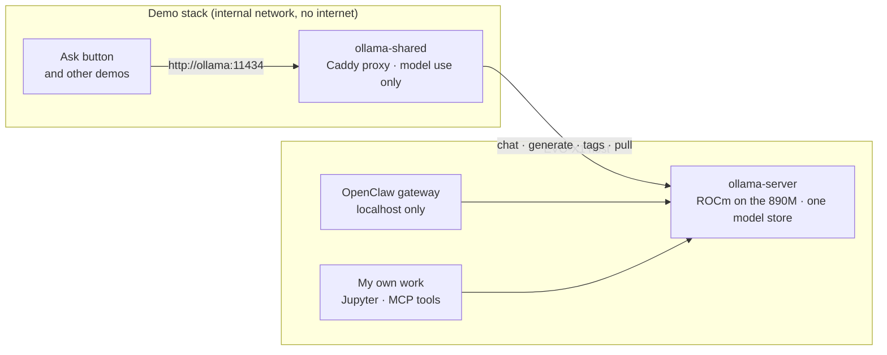

# One local model server instead of two, and an agent that runs on it

My mini PC was running two copies of Ollama. One was the GPU build I use myself. The other was a CPU-only server
inside the hardened stack behind this site's live demos, holding 7.2 GB of memory to serve a small model. I merged
them, retuned the one that remained, and set up OpenClaw, an open-source agent, on top of it. This post covers what
changed, the numbers, the decision I reversed, and what the agent is for.

<!-- more -->

**Stack:** Ollama (ROCm), Docker Compose, Caddy, OpenClaw, Tailscale

## The problem

The machine is a GMKtec EVO-X1: a Ryzen AI 9 HX 370 with Radeon 890M integrated graphics and 64 GB of RAM. The
graphics chip has no memory of its own. The BIOS gives it a fixed 32 GB and leaves Linux about 30 GB. That split
decides everything else, because a model either fits in the GPU's 32 GB or spills onto the CPU and slows down.

Two Ollama servers on a box like this is waste:

- **Memory.** The demo stack's copy had 7.2 GB loaded when I checked, out of a 14 GB cap. That's a quarter of the
  RAM Linux has.
- **Disk.** Each server kept its own model store, so any model both needed was downloaded twice.
- **Speed.** The demo copy was the plain CPU image with no GPU access. The site's **Ask** button was running on the
  slowest hardware in the house.

## The decision: one server, chosen in one setting

I didn't want to hard-code the EVO-X1's arrangement into the demo stack, because the stack should still run on a
machine with no Ollama of its own. So it's now a setting in the stack's `.env`:

| Setting | What runs | When to use it |
|---|---|---|
| `OLLAMA_BUNDLED=1` (default) | The stack's own Ollama, as before | Any machine without one |
| `OLLAMA_SHARED=1` | A small proxy that answers to the same name and forwards to the machine's own Ollama | The EVO-X1 |

The apps still call `http://ollama:11434` and still sit on an internal network with no route out. Only the
proxy, a 128 MB Caddy container, can reach the host. Nothing in the apps changed, and switching back is two lines.

The proxy is also an access rule. The shared server is now my private one too, so the demos get model *use* only:
chat, generation, embeddings, listing and downloading a model. Any request that would delete, create, copy or push a
model gets a 403. I tested every one of those paths against the proxy before shipping it.

## The decision I reversed

When I first wrote up [this machine](private-local-ai.md), I said I kept the public Ask button on a separate,
boxed-in Ollama on purpose, so a burst of visitors couldn't reach the private models or starve them. Merging the
two servers undoes that, and I want to be plain about the trade:

| | Separate servers (before) | One shared server (now) |
|---|---|---|
| Memory | ~7 GB held twice | Held once |
| Ask button speed | CPU only | GPU |
| Who can reach private models | Nobody from the demos | The demos, through a proxy that only allows model use |
| A burst of visitors | Capped at 8 cores and 14 GB | Queues behind my own jobs, and mine queue behind it |
| Limits | Set in the demo stack | Set once, on the shared server |

The queueing is the real cost. The server now handles one request at a time, so a long job of mine makes the Ask
button wait, and the reverse. On a personal site with modest traffic I'll take that for the memory and the GPU. A
firm with real traffic should keep them apart.

## Tuning the one that's left

With one server doing everything, its defaults mattered. The before-and-after:

| Setting | Before | Now | Why |
|---|---|---|---|
| Requests at once | 2 | 1 | Each parallel slot reserves its own working memory |
| Models loaded together | Automatic | 2 | The small Ask model plus one large one, without them evicting each other |
| Flash attention | Off | On | Less working memory per request |
| Context cache | Full precision | 8-bit | Roughly halves the context memory |
| Context window | Model default | 8,192 tokens | Enough for drafts and code; bigger costs memory every time |
| Idle unload | 5 minutes | 30 minutes | Back-to-back jobs skip a 25-second reload |

All of this lives in one compose file, which is now in git with the password moved out of it.

## Choosing the model: a 70B that won't fit, a 30B that flies

I started out wanting Llama 3.3 70B. I didn't run it, and the arithmetic is why. At 4-bit it's about 43 GB of
weights before any context, which is more than the GPU's 32 GB. The rest would run on the CPU. Generation speed on
this chip is limited by memory bandwidth, so I'd expect somewhere around 1.5 to 2 tokens a second even if it all fit. That's an estimate, not a measurement, and it was enough to look elsewhere.

What I ran instead was `qwen3-coder:30b`, a mixture-of-experts model. It stores 30 billion parameters but uses
roughly 3 billion for each token, so bandwidth stops being the bottleneck. Measured on the box:

| Measure | Result |
|---|---|
| Size | 19 GB, entirely on the GPU |
| Generation speed | 24.6 tokens a second |
| A 2,034-token answer (code, tests, explanation) | 82.6 seconds to generate |
| First load | 25 seconds |

That's one run on one prompt, so treat it as a first reading rather than a benchmark. The quality story is more
interesting than the speed, and it's the subject of a follow-up post, once I have more than one run: the code was
right in normal cases, its own tests passed, and a review still found three ways it accepted bad input.

## What broke along the way

None of it was hard. All of it cost time, and all of it is the kind of thing that bites in production too.

- **A name collision.** The Ollama container was created by a compose file I'd forgotten about. My hand-typed
  `docker run` kept colliding with the name, and twice left containers stuck in "Created". The fix was to change
  the compose file, not fight it.
- **`127.0.0.1` inside a container.** The agent's settings pointed at `127.0.0.1` for the database and the model.
  Inside a container that address is the container itself. Services in the same compose file are reached by name.
- **An agent stuck in its setup wizard.** OpenClaw was stuck in a restart loop. It was started without the
  command for its server, so it opened the interactive setup on every boot, found no keyboard, and exited.
- **Settings that didn't stick.** I edited OpenClaw's config file directly. The running gateway wrote its own copy
  back over it within minutes. Changes have to go through its `config set` command, or be made with it stopped.

## What OpenClaw is, and what it lets me do

OpenClaw is an open-source agent gateway. It runs all the time, keeps memory between sessions, and can use tools:
read and write files in its workspace, run commands, query the sandbox database. Mine runs `qwen3-coder:30b` on the
shared Ollama, so every token is generated in my house and costs nothing per use.

What that gives me today:

- **An agent with no meter running.** Long, repetitive jobs (tidying notebooks, drafting, summarising files) don't
  touch a usage limit or a bill.
- **Private by construction.** It works on data on my disk with a model on my GPU. Nothing in that loop leaves the
  house.
- **Always on.** It runs as a service, not a chat window I have to keep open, and I can reach its control page from
  my laptop or phone over Tailscale.

What it doesn't do yet: I haven't connected it to any messaging channel or scheduled any jobs. Those are the next
step, and I'll add them one at a time.

## Locking it down

OpenClaw ships a security audit, and its first run returned one critical finding that I agree with.

**A small model with web access is easy to steer.** A 30B model is far easier to talk round than a frontier model.
With web search and browser control switched on, a page it read could carry instructions to run commands, and this
agent can reach my workspace and database. So the local model has no web or browser tools at all. When I need
research, Claude does it.

The rest of what I changed:

| Change | Why |
|---|---|
| "Elevated" tools off | No commands outside its normal limits until I need one |
| Login rate limiting on | The gateway token can't be brute-forced |
| Plain-HTTP sign-in off | I reach it through an SSH tunnel or Tailscale's HTTPS, never plain HTTP |
| Control page on `127.0.0.1` only | Not reachable from the home network |

The audit also recommends running every tool call in its own Docker sandbox. I didn't. From inside a container,
that means handing the agent the machine's Docker socket, which is the same as giving it root on the host. The
container it already runs in is the boundary, and the re-run audit comes back clean apart from that note.

## What I'd do differently

- **Check what owns a container before touching it.** One `docker inspect` for the compose labels would have saved
  most of the detour.
- **Do the memory arithmetic before downloading.** Weights plus context against what the GPU actually has rules a
  model in or out in two minutes.
- **Run a new agent's security audit before its first task, not after.** The finding was obvious once stated.

## What's next

- **Move real work onto the local model** and measure what it saves: the local model drafts, Claude reviews. That's
  a follow-up post, published once it has a month of real runs.
- **Lock down the sandbox database** the same way: password out of the file, listening on this machine only.
- **Connect one OpenClaw channel** and give it one scheduled job, then decide whether it earns a second.
